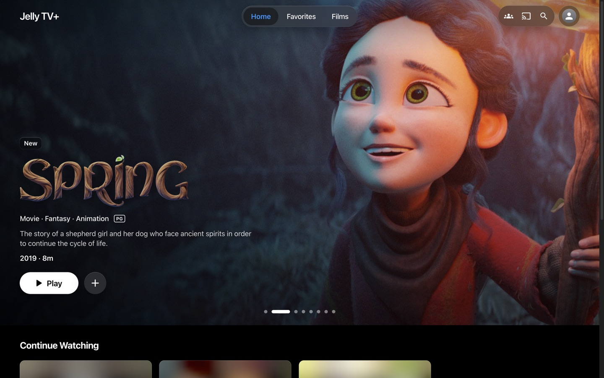
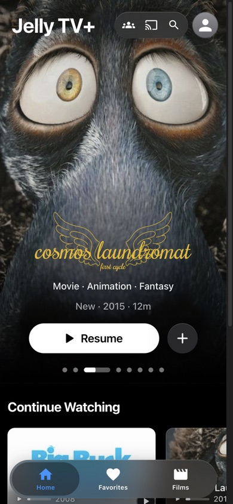
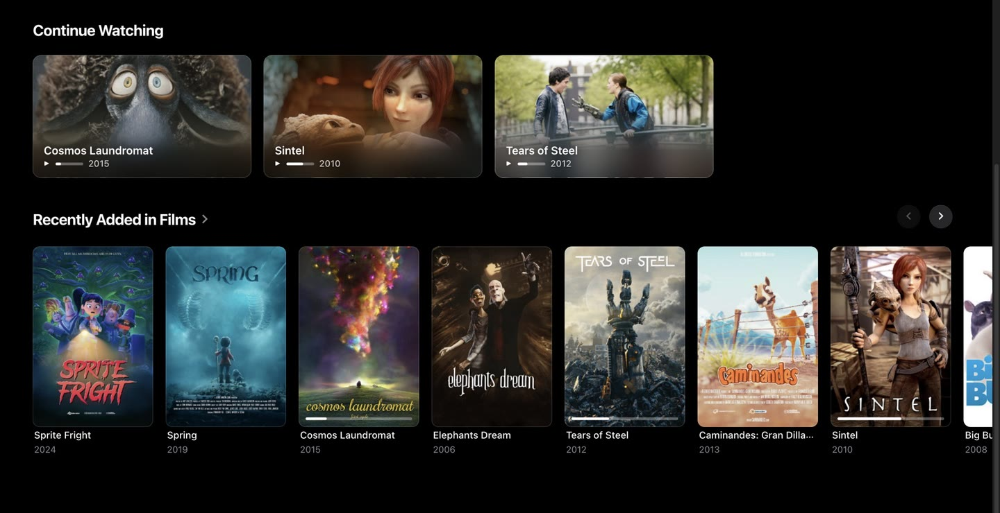
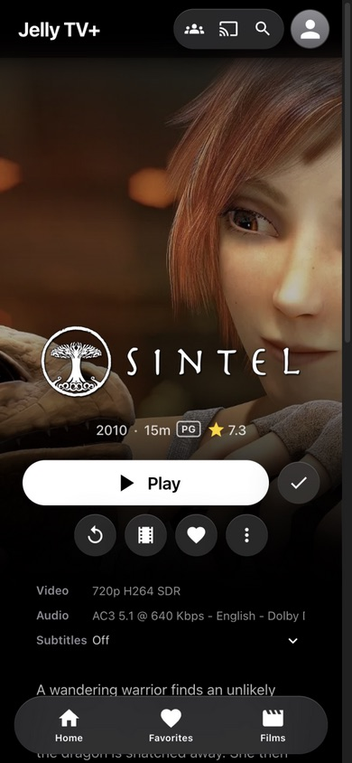
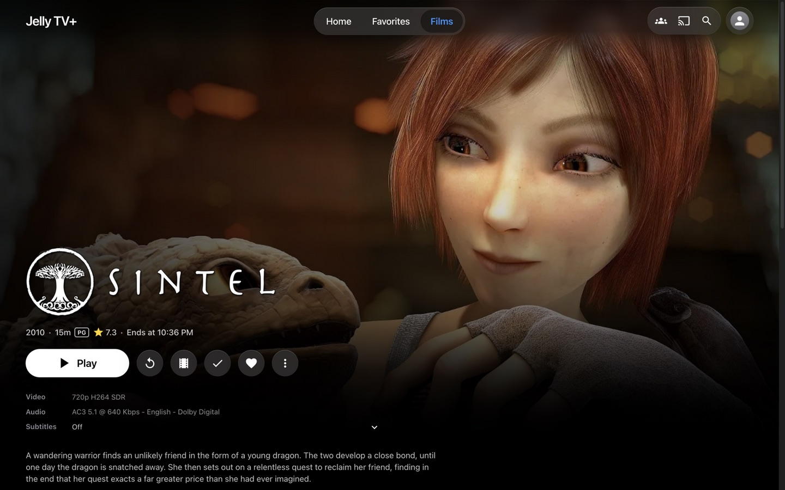
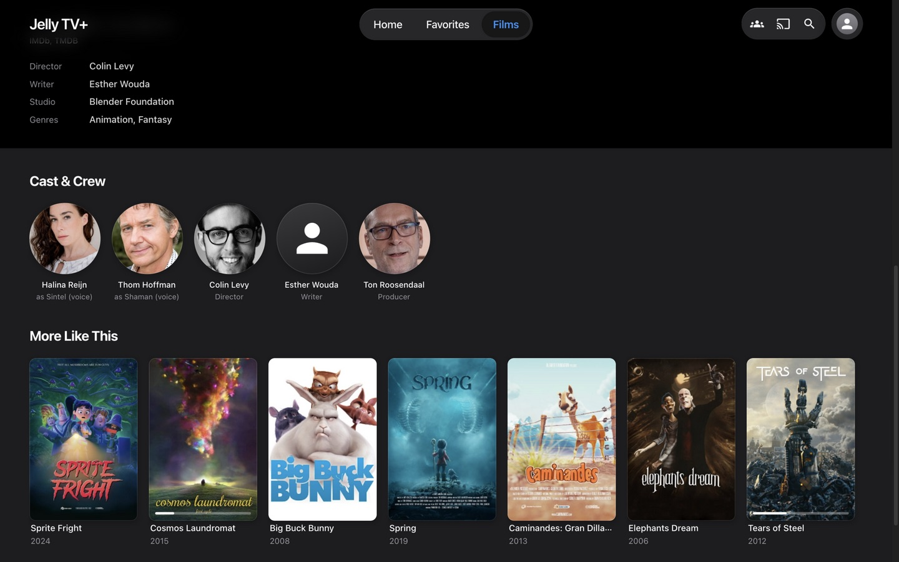
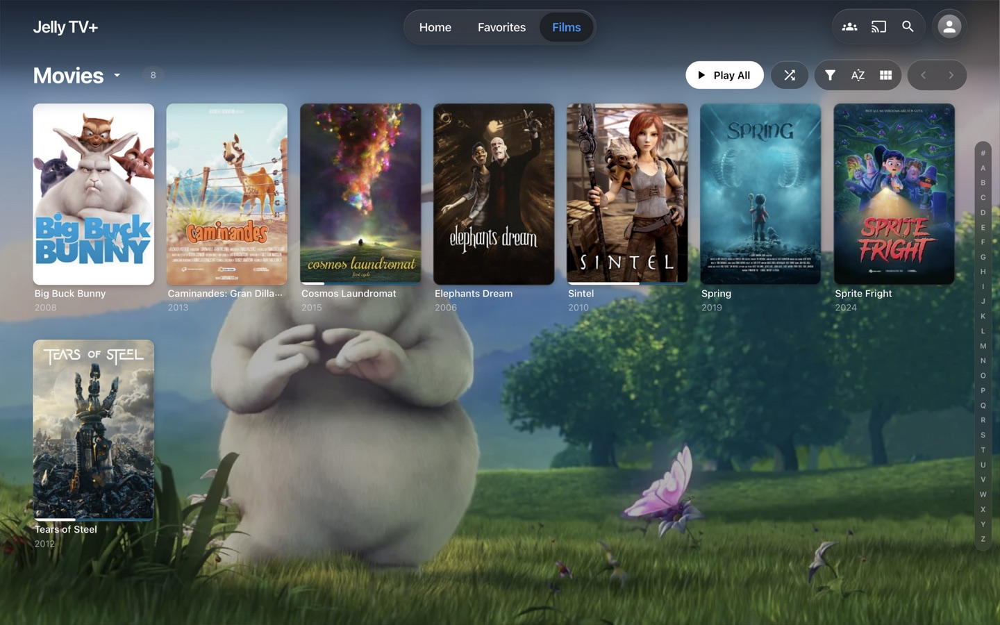
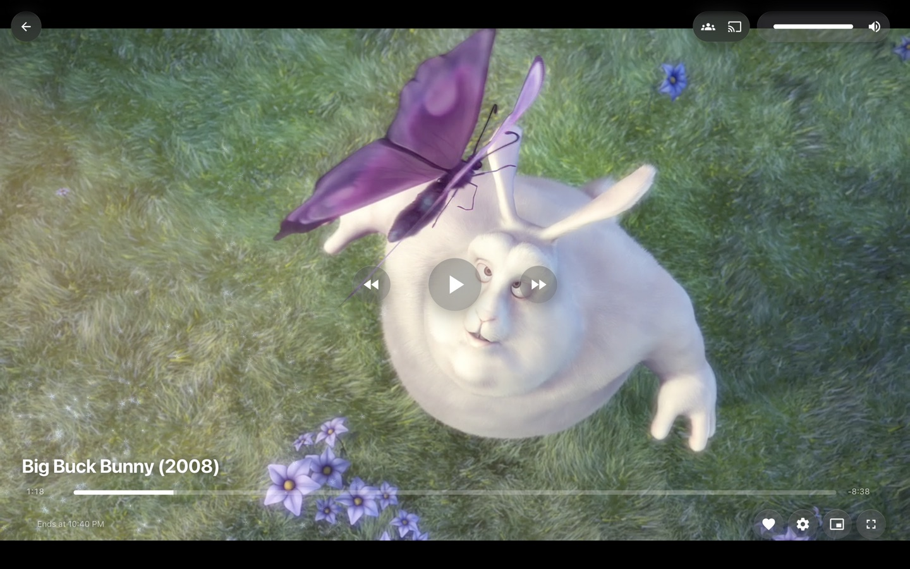
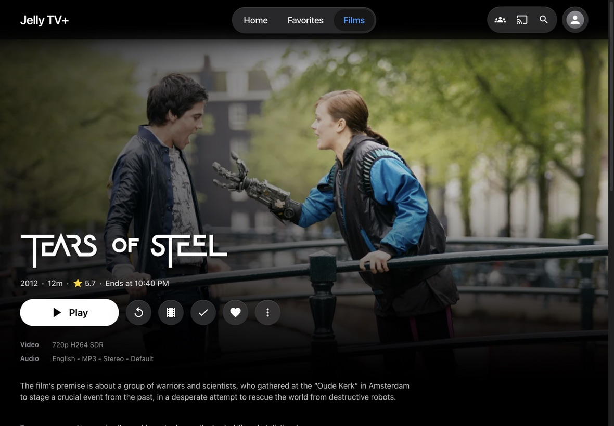
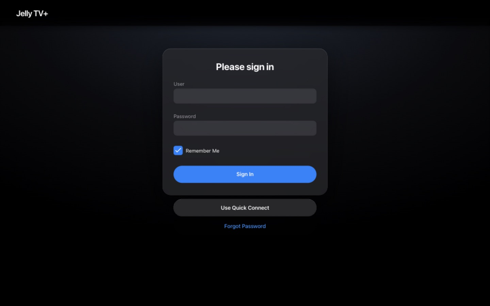

# Jelly TV+

Make your Jellyfin server look and feel like the Apple TV app.

Jelly TV+ is a free theme for [Jellyfin](https://jellyfin.org). It changes how Jellyfin looks
in a web browser and on iPhone and iPad. It is turned off on TVs (see *Samsung TVs* below).
Your movies and shows stay exactly the same; only the look changes.

Made for **Jellyfin 12.2**. It may need small fixes on other versions.

The screenshots use free, openly licensed films from the
[Blender Foundation](https://studio.blender.org/films/) (see *Credits* below).

| Home | iPhone |
| --- | --- |
|  |  |
| **Home: Continue Watching and Recently Added** | **iPhone movie page** |
|  |  |
| **Movie page** | **Cast and similar movies** |
|  |  |
| **Library** | **Video player** |
|  |  |
| **iPad** | **Sign in** |
|  |  |

## What you get

- **A big rotating banner on the Home screen** showing your newest movies and shows, with the
  title logo, a short description and a white **Play** button. It changes every few seconds;
  you can also tap the dots or swipe. Under it: *Continue Watching*, then *Recently Added*.
- **"Jelly TV+" at the top** instead of the Jellyfin logo, in Apple's own font on Apple devices.
- **See-through "glass" buttons and menus**, like the newest Apple designs.
- **A floating menu bar** (Home, Favorites, Movies, Shows…) at the top on computers and iPads,
  and at the bottom on iPhones.
- **Movie and show pages** with full-screen artwork, the title logo, and a white Play button.
- **Episodes shown as a row of picture cards**, like the Apple TV app.
- **A cleaner video player** with big round buttons in the middle of the screen.
- **Round cast photos**, rounded posters, and smooth hover and focus effects.
- **Quality labels under movie titles**, like `4K` or `1080p`, plus `DV` (Dolby Vision) or `HDR10`, on movie cards and in the Home banner
  when a movie has it. Jelly TV+ reads them from the movie file on your server. This part is in
  `jellytv-plus.js`, so it needs the plugin (see *Part 2* below).

## How to install

There are two parts:

1. **The look** (colors, buttons, layout). This is the file `jellytv-plus.css`.
2. **The Home screen banner**. This is the file `jellytv-plus.js`. It needs one free plugin.

You can install just part 1 if you like. Everything works without part 2; the Home screen
simply starts with *Continue Watching* instead of the banner.

### Part 1: the look (2 minutes)

1. Open Jellyfin and sign in as an administrator.
2. Go to **Dashboard → General**.
3. Find the box called **Custom CSS**.
4. Open `jellytv-plus.css` from this project, copy everything in it, and paste it into that box.
5. Click **Save**, then refresh the page.

### Part 2: the Home screen banner

1. In Jellyfin, go to **Dashboard → Plugins → Repositories** and add the plugin address for
   your Jellyfin version, from the
   [JavaScript Injector page](https://github.com/n00bcodr/Jellyfin-JavaScript-Injector).
   For Jellyfin 12 it is:
   `https://raw.githubusercontent.com/n00bcodr/jellyfin-plugins/main/12/manifest.json`
2. Go to **Dashboard → Plugins → Catalog**, install **JavaScript Injector**, then restart Jellyfin.
3. Open the plugin's settings, add a new script named **Jelly TV+**, paste in everything from
   `jellytv-plus.js`, and save.
4. Refresh the Jellyfin page. If the banner does not appear, see *Troubleshooting* below.

### Optional: install or update with one command

If you are comfortable with a terminal, `scripts/deploy.py` does both parts for you. It saves a
backup of your current settings first and checks that everything was saved correctly. It only
needs Python 3, nothing else.

1. In Jellyfin, go to **Dashboard → API Keys** and create a new key.
2. Save that key in a file on your computer, for example `~/.jellyfin-token`. Keep this file
   private and never share it or commit it to Git.
3. Run (replace the address with your server's address):

```sh
# Preview what would change. Nothing is saved.
python3 scripts/deploy.py --server http://YOUR-SERVER:8096 --token-file ~/.jellyfin-token --dry-run

# Install or update
python3 scripts/deploy.py --server http://YOUR-SERVER:8096 --token-file ~/.jellyfin-token
```

Backups go into a `backups` folder, which Git ignores.

## Samsung TVs

The theme is turned off on TVs on purpose. TV apps, like the Samsung (Tizen) Jellyfin app, keep
Jellyfin's normal look. Jellyfin marks its TV layout with a class called `layout-tv`, and the
theme does nothing on a page that has it. The Home screen banner does not show on TVs either.

- **Fully close and reopen the TV app** after installing or updating the theme. TVs often keep
  apps paused in the background, so the old look can stay until the app really restarts.
- If you see gray bars around videos on a Samsung TV, add the small fix in
  `overrides/samsung-tv.css` to the end of your Custom CSS. With the command above, add
  `--override overrides/samsung-tv.css`.

## Troubleshooting

**The Home banner does not show up after installing the plugin.**
Your browser may still be using an old copy of Jellyfin's start page. If Jellyfin runs in
Docker, run this once on the server and then refresh the page:

```sh
docker exec jellyfin touch /jellyfin/jellyfin-web/index.html
```

You may need to run it again after updating Jellyfin.

**I changed the theme but my device still shows the old look.**
Refresh the page. On phones, tablets and TVs, close the app completely and open it again.

**I want my old look back.**
Delete everything in **Dashboard → General → Custom CSS**, and turn off or delete the
**Jelly TV+** script in the JavaScript Injector settings.

## Good to know

- **Fonts:** Apple devices show Apple's own font (SF Pro). Other devices use **Inter**, a very
  similar free font, loaded from Google Fonts.
- **Icons:** the icons are Jellyfin's own, recolored to match. Apple's icons cannot be used here.
- **Browser tab:** the browser tab title still says "Jellyfin".
- **Updates:** a big Jellyfin update can move things around. If something looks wrong after an
  update, please open an issue.

## Credits

All films in the screenshots are open movies made by the Blender Foundation / Blender Studio
and shared under Creative Commons Attribution (CC BY) licenses, which allow sharing as long as
the film is credited:

| Film | Made by | License |
| --- | --- | --- |
| Elephants Dream (2006) | Blender Foundation and Netherlands Media Art Institute | [CC BY 2.5](https://creativecommons.org/licenses/by/2.5/) |
| Big Buck Bunny (2008) | Blender Foundation | [CC BY 3.0](https://creativecommons.org/licenses/by/3.0/) |
| Sintel (2010) | Blender Foundation | [CC BY 3.0](https://creativecommons.org/licenses/by/3.0/) |
| Tears of Steel (2012) | Blender Foundation | [CC BY 3.0](https://creativecommons.org/licenses/by/3.0/) |
| Caminandes 2: Gran Dillama (2013) | Blender Foundation | [CC BY 3.0](https://creativecommons.org/licenses/by/3.0/) |
| Cosmos Laundromat (2015) | Blender Institute | [CC BY 4.0](https://creativecommons.org/licenses/by/4.0/) |
| Spring (2019) | Blender Animation Studio | [CC BY 4.0](https://creativecommons.org/licenses/by/4.0/) |
| Sprite Fright (2021) | Blender Studio | [CC BY 4.0](https://creativecommons.org/licenses/by/4.0/) |

More about these films: [studio.blender.org/films](https://studio.blender.org/films/).

Movie details and artwork in the screenshots were loaded by Jellyfin from
[TMDB](https://www.themoviedb.org/). This project uses the TMDB API but is not endorsed or
certified by TMDB.

## License

The code is free for anyone to use, change, share or sell, for any purpose, with no need to
ask or give credit ([The Unlicense](LICENSE), public domain).

The pictures in the `screenshots` folder are the exception: they show Blender Foundation films,
which keep their own Creative Commons licenses (see *Credits* above).

## Disclaimer

Jelly TV+ is a fan-made theme. It is not made by, supported by, or connected to Apple, the
Jellyfin project or the Blender Foundation. "Apple TV" is a trademark of Apple Inc.
